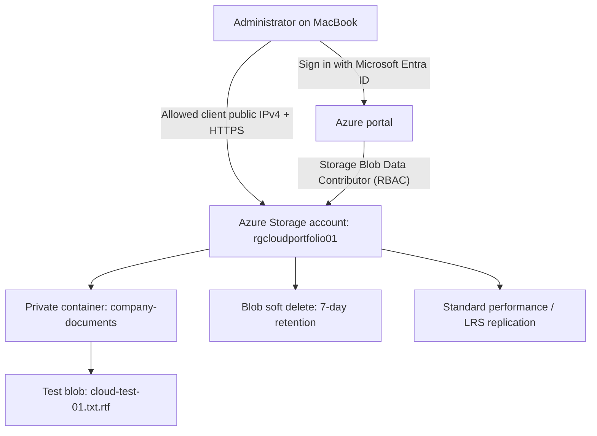

# Azure Secure Blob Storage Lab

**Cloud engineering portfolio | Microsoft Azure | Beginner infrastructure and support lab**

## Overview

This hands-on lab demonstrates provisioning and administering a secure Azure Blob Storage environment. It includes storage configuration, identity and access management (RBAC), network firewall troubleshooting, file transfer verification, and recovery of a soft-deleted blob.

**Project type:** Personal technical lab / simulated support tasks (not paid employment)  
**Lab completed:** 30 October 2026  
**Region:** UK South

## Architecture

The diagram is a conceptual view. Storage management uses Microsoft Entra authorization; the storage firewall restricts network access to approved IP addresses. It does **not** represent a production network design.

## Azure resources and configuration

| Component | Configuration |
| --- | --- |
| Resource group | `rgcloudportfolio01` |
| Storage account | `rgcloudportfolio01` |
| Storage account kind | General-purpose v2 (StorageV2) |
| Region | UK South |
| Performance | Standard |
| Replication | Locally redundant storage (LRS) |
| Blob access tier | Hot |
| Container | `company-documents` |
| Container access | Private; anonymous access disabled |
| Identity | Microsoft Entra ID |
| RBAC | Storage Blob Data Contributor, scoped to the storage account |
| Storage account key access | Disabled |
| Secure transfer | Required; minimum TLS 1.2 |
| Network firewall | Selected networks/IP addresses; client IPv4 allowed |
| Private endpoint | Not configured |
| Encryption at rest | Microsoft-managed keys |
| Blob/container soft delete | Enabled; 7-day retention |

> **Security note:** No account keys, subscription IDs, credentials, private data, or public IP addresses should be committed to this repository.

## Implementation steps

1. Created an Azure resource group in UK South.
2. Deployed a Standard StorageV2 storage account with LRS replication.
3. Configured network restrictions, TLS, encryption, and blocked anonymous blob access.
4. Disabled shared-key authorization and enabled Microsoft Entra authorization in the Azure portal.
5. Assigned the **Storage Blob Data Contributor** role to the lab user at the storage account scope.
6. Created the private `company-documents` Blob container.
7. Uploaded a synthetic test document and downloaded it to verify its content.
8. Simulated accidental deletion, located the soft-deleted blob, restored it, and downloaded it again.

## Troubleshooting exercise — HTTP 403 / unauthorized upload

**Symptom:** The Azure portal rejected an attempted blob upload with the message *"This request is not authorized to perform this operation."*

**Diagnosis:** Confirmed the Storage Blob Data Contributor assignment. Then inspected **Storage account → Networking**, where the storage firewall was set to selected networks but **no client IPv4 address** was permitted.

**Resolution:** Added the current client public IPv4 address to the storage firewall allowlist without opening access to all networks.

**Result:** Retried the upload; Azure reported **"Successfully uploaded 1 blob(s)."**

**Learning:** Azure Blob operations can require both correctly scoped identity permissions and allowed network connectivity. An authorization-style error does not always mean the RBAC role is missing.

## Simulated support ticket — Recover accidentally deleted file

**Ticket:** LAB-001  
**Scenario:** A user accidentally deleted a company test document.  
**Impact:** One synthetic document temporarily unavailable.

**Actions taken:**
1. Deleted only the test blob `cloud-test-01.txt.rtf` from `company-documents`.
2. Changed the container view to **Show active and deleted blobs**.
3. Located the file with **Deleted** status and used **Undelete**.
4. Azure confirmed **"Successfully undeleted 1 blob(s)."**
5. Downloaded the restored file and verified it opened with the same content as before deletion.

**Outcome:** Successfully recovered the test blob within the configured soft-delete retention period.

**Important limitation:** Blob soft delete is a recovery feature, not a complete backup or disaster recovery strategy.

## Validation results

| Test | Result |
| --- | --- |
| Storage account provisioned successfully | Pass |
| Private container created | Pass |
| Microsoft Entra RBAC role assignment present | Pass |
| Blocked upload under restrictive firewall | Observed |
| Upload succeeded after client IP allowlisting | Pass |
| File downloaded and contents checked | Pass |
| Soft-deleted blob restored | Pass |
| Restored file downloaded and contents checked | Pass |

## Evidence to add

Add redacted screenshots to an `evidence/` folder. Suggested files:

- `01-storage-overview.png` — StorageV2, UK South, LRS
- `02-rbac-role.png` — Storage Blob Data Contributor (hide user identifiers)
- `03-networking.png` — selected network access and one IP rule (hide the IP)
- `04-private-container.png` — `company-documents` with private access
- `05-upload-success.png` — successful blob upload
- `06-soft-delete.png` — deleted blob in retention
- `07-recovery-success.png` — successful Undelete
- `08-restored-file.png` — recovered document opened successfully

Do not upload unredacted account IDs, email addresses, public IP addresses, tokens, connection strings, or customer data.

## Cost control and cleanup

This is a low-volume lab, **not a guaranteed free deployment**. Azure storage, transactions, retained deleted data, and optional services can create charges. A budget alert is not a spending cap.

When the lab and screenshots are complete, review Azure Cost Management and delete the unused lab resource group **only after confirming it contains no resources you need**. Deleting a resource group deletes its included resources and their stored data.

## Skills demonstrated

- Azure resource provisioning and resource groups
- Blob Storage, private containers, Hot tier, LRS
- Microsoft Entra ID and Azure RBAC
- Azure Storage firewalls and client IP allowlisting
- TLS and encryption fundamentals
- Diagnosing storage access failures
- Secure file upload, download, and validation
- Blob soft-delete recovery and incident documentation

## Next learning project

Deploy and administer a small Azure virtual machine, practise secure remote access, OS updates, monitoring and cleanup, and document the resulting support tickets.

## References

- [Azure Blob Storage overview](https://learn.microsoft.com/en-us/azure/storage/blobs/storage-blobs-overview)
- [Create a storage account](https://learn.microsoft.com/en-us/azure/storage/common/storage-account-create)
- [Azure Storage network security](https://learn.microsoft.com/en-us/azure/storage/common/storage-network-security)
- [Authorize blob access with Microsoft Entra ID](https://learn.microsoft.com/en-us/azure/storage/blobs/authorize-access-azure-active-directory)
- [Blob soft delete](https://learn.microsoft.com/en-us/azure/storage/blobs/soft-delete-blob-overview)
